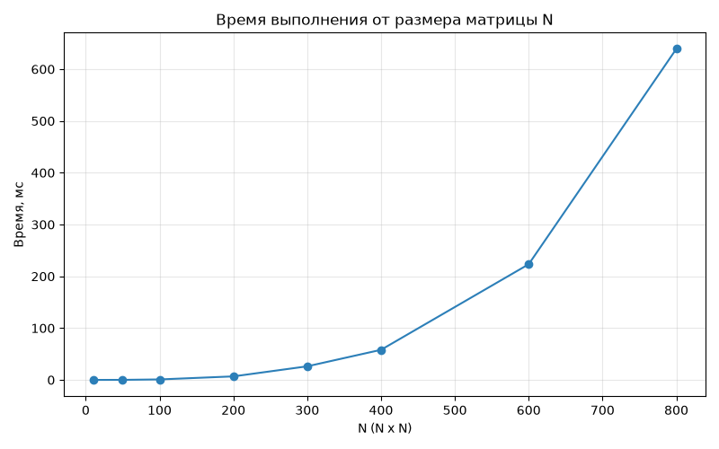
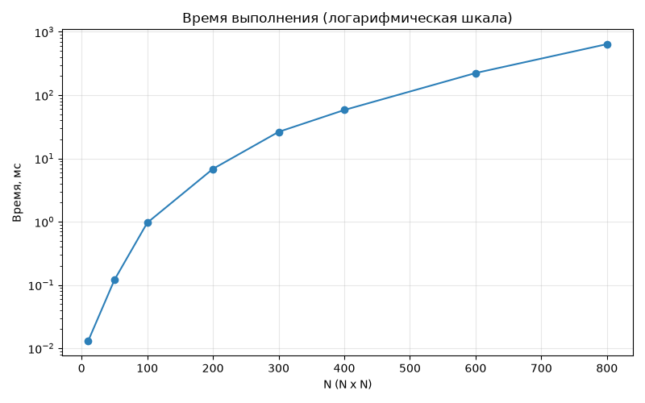
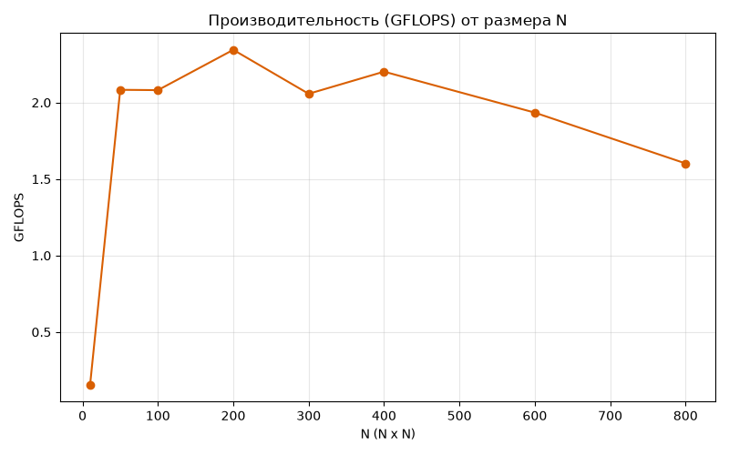

# Лабораторная работа 1 — умножение квадратных матриц (C++)

## 1. Задача

Написать программу на C++, которая перемножает две квадратные матрицы
`C = A * B`. Матрицы берутся из файлов, результат тоже пишется в файл.
Плюс нужно записывать время выполнения и объём задачи, и проверять
результат сторонней программой — я использую NumPy.

## 2. Что где лежит

| Файл / папка | Что это |
|---|---|
| `main.cpp` | сама программа умножения |
| `matrix.exe` | собранный exe-файл |
| `Matrix(A).txt`, `Matrix(B).txt` | пример матриц 4×4 |
| `RESULT.txt` | результат по этому примеру, `stats.txt` — статистика по нему |
| `verify.py` | проверяет один результат через NumPy |
| `final.txt` | короткий отчёт по примеру 4×4 |
| `scripts/benchmark.py` | гоняет программу на разных размерах и проверяет каждый результат, сохраняет `scripts/results.csv` |
| `scripts/build_charts.py` | рисует графики (matplotlib) по `results.csv` |

## 3. Формат файлов с матрицами

```
N
a11 a12 ... a1N
a21 a22 ... a2N
...
aN1 aN2 ... aNN
```

Первая строка — размер `N`, дальше `N` строк по `N` чисел. Результат
пишется в таком же формате.

## 4. Как устроено умножение

Порядок циклов — `i-k-j`, а не привычный `i-j-k`. Так процессор читает
матрицу `B` построчно, а не вразброс, и меньше "промахивается" мимо
кэша — из-за этого умножение получается заметно быстрее:

```cpp
for (int i = 0; i < _n; ++i) {
    for (int k = 0; k < _n; ++k) {
        const long long a = arow[k];
        for (int j = 0; j < _n; ++j) {
            crow[j] += a * brow[j];
        }
    }
}
```

Сложность — `O(N³)`. Объём задачи считаю как `N³` (число умножений),
а если считать ещё и сложения — получится `2·N³`. Время меряю только
вокруг самого умножения (`std::chrono::high_resolution_clock`), чтение
и запись файлов в замер не попадают.

## 5. Сборка и запуск

```powershell
g++ -O2 -std=c++17 main.cpp -o matrix.exe
```

```powershell
# без аргументов берутся файлы по умолчанию:
# Matrix(A).txt Matrix(B).txt RESULT.txt stats.txt
.\matrix.exe

# или явно указать свои файлы:
.\matrix.exe "Matrix(A).txt" "Matrix(B).txt" RESULT.txt stats.txt
```

Программа печатает и пишет в `stats.txt`: размер `N`, время в мс,
объём задачи и производительность в GFLOPS.

## 6. Проверка результата

```powershell
python verify.py
```

Скрипт сам считает `A @ B` через NumPy и сравнивает с `RESULT.txt`.
Числа целые, поэтому сравнение точное, без всяких допусков на
погрешность.

На примере 4×4 из репозитория результаты сходятся (см. `final.txt`).

## 7. Замеры на разных размерах

Одного примера 4×4 мало, чтобы показать, как программа ведёт себя —
нужно прогнать несколько размеров и посмотреть, как растёт время:

```powershell
pip install numpy matplotlib
python scripts/benchmark.py
python scripts/build_charts.py
```

`benchmark.py` создаёт случайные матрицы (числа от -10 до 10,
`seed = 42`, чтобы можно было повторить) для размеров
`N = 10, 50, 100, 200, 300, 400, 600, 800`, запускает `matrix.exe` и
для каждого размера сверяет результат с NumPy. Всё складывает в
`scripts/results.csv`. `build_charts.py` берёт этот файл и рисует
графики.

## 8. Результаты

Процессор: **Intel(R) Celeron(R) N5095 @ 2.00GHz** (4 потока), Windows 11.

| N | Время, мс | Операций (N³) | GFLOPS | Расхождение с NumPy | Статус |
|---:|---:|---:|---:|---:|:---:|
|  10 |   0.013 |         1 000 | 0.154 | 0 | OK |
|  50 |   0.120 |       125 000 | 2.083 | 0 | OK |
| 100 |   0.961 |     1 000 000 | 2.081 | 0 | OK |
| 200 |   6.824 |     8 000 000 | 2.345 | 0 | OK |
| 300 |  26.247 |    27 000 000 | 2.057 | 0 | OK |
| 400 |  58.126 |    64 000 000 | 2.202 | 0 | OK |
| 600 | 223.350 |   216 000 000 | 1.934 | 0 | OK |
| 800 | 639.122 |   512 000 000 | 1.602 | 0 | OK |

Все 8 прогонов сошлись с NumPy без расхождений — программа считает
правильно.

## 9. Графики

**Время от размера матрицы** (`scripts/figures/time_by_size.png`):



Видно, что время растёт кубически: N выросло с 400 до 800 (в 2 раза),
а время — почти в 11 раз (58 → 639 мс). Это чуть больше, чем даёт
чистая теория (8×) — скорее всего, потому что при N=800 матрицы уже
не помещаются целиком в кэш процессора.

**Тот же график в логарифмической шкале** (`time_by_size_log.png`):



Точки ложатся почти на прямую линию — значит, кубический рост держится
на всём диапазоне размеров, без скачков.

**Производительность (GFLOPS)** (`throughput_by_size.png`):



Держится примерно в районе `1.6–2.3` GFLOPS без явного тренда вверх
или вниз — нормально для однопоточной программы: она упирается не
в скорость процессора, а в скорость памяти.

## 10. Выводы

1. Программа считает верно — все прогоны (N от 4 до 800) сошлись с
   NumPy без расхождений.
2. Время растёт кубически (`O(N³)`), это хорошо видно на графике в
   логарифмической шкале.
3. Порядок циклов `i-k-j` даёт последовательное чтение памяти и
   работает быстрее, чем обычный `i-j-k`.
4. Получил `~1.6–2.3` GFLOPS в один поток — это будет базой для
   сравнения, когда дойдёт до распараллеливания (OpenMP/MPI/CUDA).
