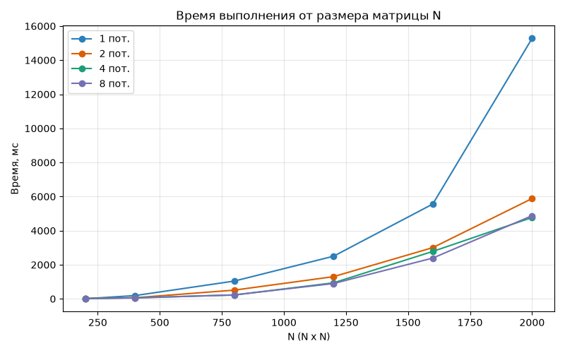
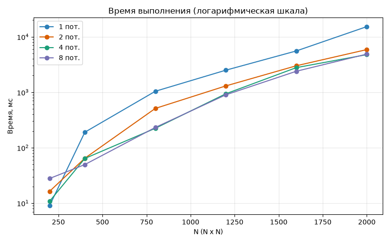
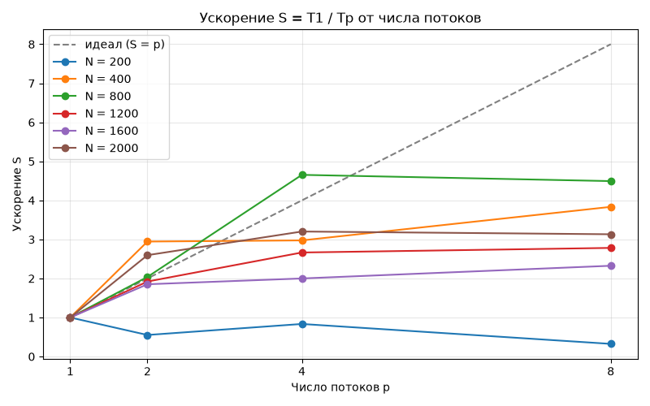
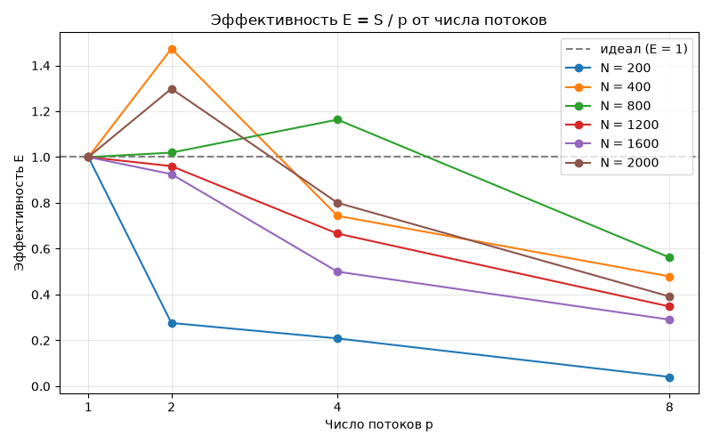
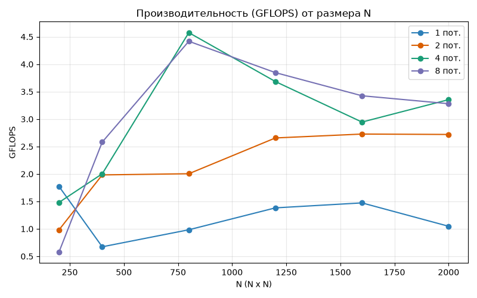

# Лабораторная работа 2 — умножение матриц с OpenMP (C++)

Дисциплина: Параллельное программирование.

Отчёт по ЛР №1 (однопоточная версия) — в [README_lab1.md](README_lab1.md).

## 1. Задача

Изучить технологию параллельного программирования OpenMP. Модифицировать
программу умножения квадратных матриц из ЛР №1 для параллельной работы.
Провести серию экспериментов с разным числом потоков и разными размерами
матриц, оценить эффективность распараллеливания.

## 2. Что где лежит

| Файл / папка | Что это |
|---|---|
| `main.cpp` | программа умножения, распараллеленная через OpenMP |
| `matrix_omp.exe` | собранный exe-файл (с `-fopenmp`) |
| `gen.py` | генератор тестовых матриц `Matrix(A)_N.txt`, `Matrix(B)_N.txt` для 6 размеров |
| `run_experiments.py` | прогон серии экспериментов: 6 размеров × 4 варианта потоков = 24 запуска |
| `results.csv` | итоговая таблица: размер, потоки, время, GFLOPS |
| `stats_N_Tp.txt` | отчёт по каждому из 24 запусков |
| `scripts/build_charts_omp.py` | рисует графики по `results.csv` в `scripts/figures_omp/` |

## 3. Схема распараллеливания

Алгоритм тот же, что в ЛР №1 (порядок циклов `i-k-j`). В методе
`Matrix::multiply` распараллелен внешний цикл по строкам результата:

```cpp
#pragma omp parallel for
for (int i = 0; i < _n; ++i) {
    const auto& arow = _data[i];
    auto& crow = result._data[i];
    for (int k = 0; k < _n; ++k) {
        const long long a = arow[k];
        const auto& brow = other._data[k];
        for (int j = 0; j < _n; ++j) {
            crow[j] += a * brow[j];
        }
    }
}
```

Каждый поток получает свой набор строк `i` и пишет только в свою строку
`C[i]`, поэтому гонок данных нет и никакие `critical` / `atomic` не нужны.
Матрицы `A` и `B` только читаются. Число потоков задаётся пятым аргументом
командной строки и передаётся в `omp_set_num_threads()`.

Время, как и в ЛР №1, меряется только вокруг умножения
(`std::chrono::high_resolution_clock`), без чтения и записи файлов.
Производительность считается как `2·N³ / t` (умножения + сложения).

## 4. Сборка и запуск

```powershell
g++ -O2 -std=c++17 -fopenmp main.cpp -o matrix_omp.exe
```

```powershell
# A, B, файл результата, файл статистики, число потоков
.\matrix_omp.exe "Matrix(A)_800.txt" "Matrix(B)_800.txt" RESULT.txt stats.txt 4
```

Полная серия экспериментов и графики:

```powershell
pip install numpy matplotlib
python gen.py
python run_experiments.py
python scripts/build_charts_omp.py
```

## 5. Результаты

Процессор: **Intel(R) Celeron(R) N5095 @ 2.00GHz** (4 ядра, 4 потока), Windows 11.
Размеры `N = 200, 400, 800, 1200, 1600, 2000`, потоки `p = 1, 2, 4, 8`.
Элементы матриц — случайные целые от 1 до 9.

Время выполнения, мс:

| N | 1 поток | 2 потока | 4 потока | 8 потоков |
|---:|---:|---:|---:|---:|
|  200 |      9.0 |   16.3 |   10.8 |   27.8 |
|  400 |    190.1 |   64.5 |   63.9 |   49.6 |
|  800 |   1041.5 |  510.9 |  223.8 |  231.8 |
| 1200 |   2499.8 | 1301.0 |  938.1 |  898.4 |
| 1600 |   5561.1 | 3003.6 | 2780.9 | 2391.8 |
| 2000 |  15274.5 | 5882.2 | 4770.1 | 4877.1 |

Производительность, GFLOPS:

| N | 1 поток | 2 потока | 4 потока | 8 потоков |
|---:|---:|---:|---:|---:|
|  200 | 1.77 | 0.98 | 1.48 | 0.58 |
|  400 | 0.67 | 1.98 | 2.00 | 2.58 |
|  800 | 0.98 | 2.00 | 4.58 | 4.42 |
| 1200 | 1.38 | 2.66 | 3.68 | 3.85 |
| 1600 | 1.47 | 2.73 | 2.95 | 3.43 |
| 2000 | 1.05 | 2.72 | 3.35 | 3.28 |

Ускорение `S = T1 / Tp` и эффективность `E = S / p`:

| N | S (2) | S (4) | S (8) | E (2) | E (4) | E (8) |
|---:|---:|---:|---:|---:|---:|---:|
|  200 | 0.55 | 0.83 | 0.32 | 0.28 | 0.21 | 0.04 |
|  400 | 2.95 | 2.97 | 3.83 | 1.47 | 0.74 | 0.48 |
|  800 | 2.04 | 4.65 | 4.49 | 1.02 | 1.16 | 0.56 |
| 1200 | 1.92 | 2.66 | 2.78 | 0.96 | 0.67 | 0.35 |
| 1600 | 1.85 | 2.00 | 2.33 | 0.93 | 0.50 | 0.29 |
| 2000 | 2.60 | 3.20 | 3.13 | 1.30 | 0.80 | 0.39 |

## 6. Графики

**Время от размера матрицы** (`scripts/figures_omp/time_by_size.png`):



Однопоточная версия на N = 2000 считает ~15 с, а с 2–4 потоками —
около 5 с. Линии для 4 и 8 потоков почти совпадают: у процессора
всего 4 ядра, и больше 4 потоков реально параллельно не работают.

**Тот же график в логарифмической шкале** (`time_by_size_log.png`):



Видно, что на N = 200 многопоточные версии не быстрее, а местами
медленнее однопоточной — задача слишком маленькая (~9 мс), и время
на создание и синхронизацию потоков съедает весь выигрыш.

**Ускорение от числа потоков** (`speedup_by_threads.png`):



На 2 потоках ускорение близко к идеальному (~2×). На 4 потоках —
от 2 до 4.6×, в зависимости от размера. Переход с 4 на 8 потоков
почти ничего не даёт. Для N = 400 и N = 2000 на 2 потоках получилось
ускорение больше 2 (сверхлинейное) — скорее всего, однопоточный замер
в этих точках оказался медленнее «честного» (каждая точка — один запуск,
у Celeron плавает частота из-за турбобуста и нагрева), так что это
погрешность измерения, а не реальный эффект.

**Эффективность** (`efficiency_by_threads.png`):



Эффективность падает с ростом числа потоков: на 4 потоках для N ≥ 400
она в основном 0.5–0.8, на 8 — меньше 0.6 у всех размеров. Причина — потоки делят
общую память и кэш, и программа упирается в пропускную способность
памяти, а не в вычисления.

**Производительность (GFLOPS)** (`throughput_by_size.png`):



Один поток даёт ~1–1.8 GFLOPS (как и в ЛР №1), 4 потока — до 4.6 GFLOPS
на N = 800. Для больших N производительность снижается до ~3.3 GFLOPS:
матрицы не помещаются в кэш, и данные приходится постоянно тянуть из
оперативной памяти.

## 7. Выводы

1. Распараллеливание внешнего цикла через `#pragma omp parallel for`
   оказалось простым: строки результата независимы, синхронизация не нужна.
2. На больших матрицах (N ≥ 400) программа ускоряется в 2–4.6 раза,
   лучший результат — N = 800 на 4 потоках (S = 4.65, 4.58 GFLOPS).
3. На маленьких матрицах (N = 200) OpenMP не помогает: накладные расходы
   на потоки больше, чем само вычисление.
4. Больше потоков, чем ядер (8 на 4-ядерном процессоре), прироста
   не даёт — оптимально брать число потоков, равное числу ядер.
5. Ускорение ниже идеального из-за ограничения пропускной способности
   памяти. Улучшить можно блочным умножением (чтобы данные лучше
   помещались в кэш) и хранением матрицы одним сплошным массивом
   вместо `vector<vector>`.
