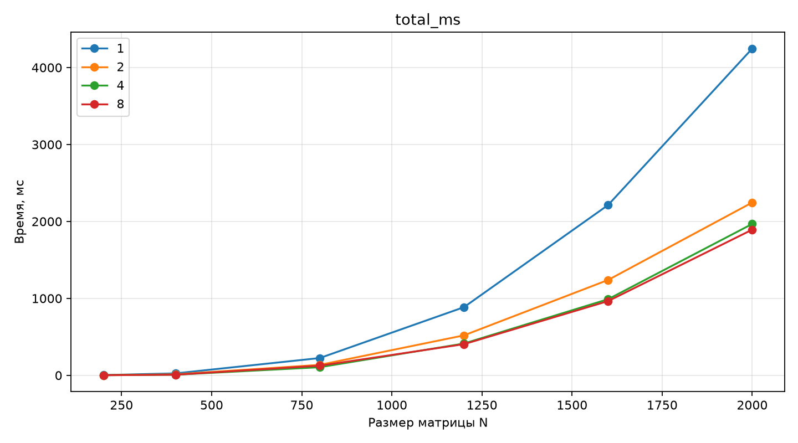
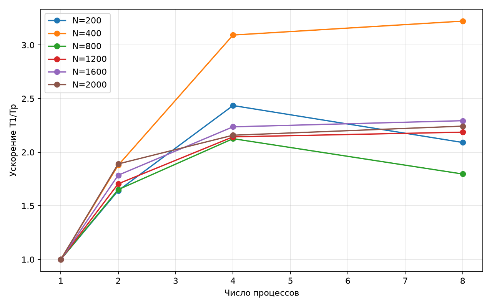
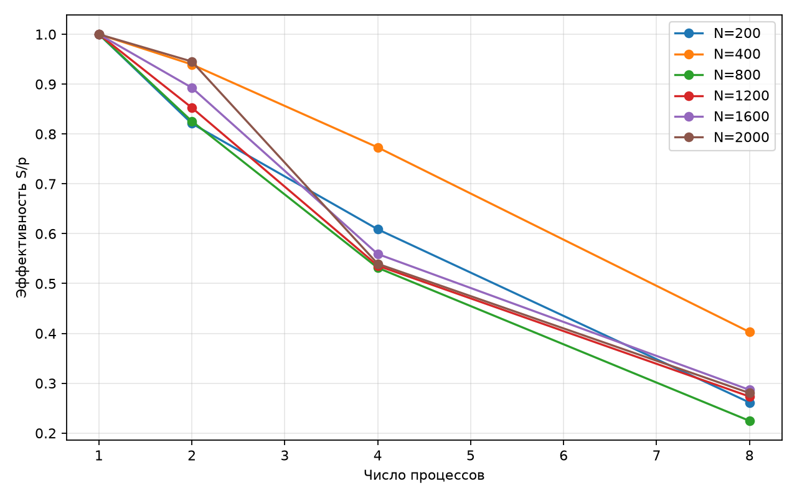

# ЛР №3: архив локальных экспериментов на Windows

Эта серия выполнена до запуска на суперкомпьютере. Основной отчёт: [README.md](README.md).

## 1. Задание

Модифицировать программу ЛР №1 для MPI, провести эксперименты для разных N
и количества вычислительных ядер. Запустить MPI-версию на «Сергее Королёве».
Результаты проверить независимой библиотекой.

## 2. Код и распределение работы

Исходный код: [main.cpp](main.cpp), общий ввод/вывод и последовательное умножение
локальных строк: [matrix.hpp](common/matrix.hpp).

Процесс 0 читает A и B, проверяет размеры и корректность файлов. Статус чтения
передаётся всем процессам, чтобы ошибка на процессе 0 не оставила остальные
ожидать рассылку данных. При непредвиденной ошибке используется `MPI_Abort`.

Для p процессов каждому выдаётся `N/p` строк, а первым `N%p` процессам — ещё
по строке. Разница нагрузки не больше одной строки. Например, N=7, p=4 даёт
2,2,2,1 строки. Если p>N, некоторые процессы получают ноль строк и всё равно
участвуют в коллективных вызовах.

Последовательность операций:

1. `MPI_Bcast` передаёт размер N, затем всю матрицу B.
2. `MPI_Scatterv` распределяет неодинаковые по размеру полосы A.
3. Каждый процесс вычисляет свои строки C тем же порядком циклов `i-k-j`,
   что и в исходной работе. Данные передаются типом `MPI_LONG_LONG_INT`.
4. `MPI_Gatherv` собирает полосы C на процессе 0, который сохраняет файл.

Полосы результата независимы, межпроцессный обмен внутри вычислительного
цикла не требуется. Матрицы хранятся в сплошном массиве, чтобы передавать
полосы без дополнительной упаковки.

Вычислительная работа одного процесса — примерно O(N³/p). Каждый хранит
полную B, поэтому расход памяти на неё остаётся O(N²) на процесс. Процесс 0
дополнительно хранит полные A и C. Централизованная раздача/сборка и дублирование B
ограничивают масштабируемость этой простой схемы; двумерное распределение —
возможное дальнейшее улучшение.

## 3. Измерение времени

Перед измерением выполняется `MPI_Barrier`. `total_ms` включает рассылку B,
раздачу полос A, умножение и сборку C. `compute_ms` включает только локальное
умножение. Оба измеряются `MPI_Wtime`; `MPI_Reduce(...,MPI_MAX)` выбирает
максимальную длительность среди процессов, а не только время процесса 0.

Чтение/запись файлов, выделение буферов, начальная рассылка N, старт процессов
и редукция статистики исключены. Времена измеряются как разности на каждом
процессе, поэтому синхронизация абсолютных часов между узлами не требуется.
`total_ms − compute_ms` не является точным временем коммуникации: максимумы
могут соответствовать разным процессам и включают ожидание.

Производительность `2*N³/t` указана в GOPS для целочисленной арифметики.
Ускорение `S=T1/Tp`, эффективность `E=S/p`; T1 — та же MPI-программа с одним
процессом, а не старые замеры ЛР №1 на другом компьютере.

## 4. Локальное окружение и проверка

6 ноября 2026: Windows 10, Intel Core i5-11400F, 6 физических ядер / 12 логических
процессоров; MS-MPI 10.1.1, MSVC 14.44, `/O2 /std:c++17`.
Метаданные: [environment.json](results_local/environment.json).

В этой локальной серии изменялось число MPI-процессов (1,2,4,8); жёсткое
закрепление процессов за физическими ядрами не задавалось. Поэтому p=8
не означает восемь физических ядер. Это локальная проверка программы и
её поведения, а не выполнение требования о суперкомпьютерных экспериментах.

Вход: N=200,400,800,1200,1600,2000; целые −10…10, seed `42+N`.
Три повторения каждой комбинации — **72 запуска**, каждый с полной проверкой
результата через NumPy. Все совпали, максимальная абсолютная ошибка — 0.
Дополнительно прошли **30 граничных проверок**, включая N<p, некратные N/p,
неполные/избыточные файлы, несовпадающие размеры и риск переполнения:
[checks.json](checks.json).

## 5. Локальные результаты

Медиана `total_ms`, мс:

| N | 1 процесс | 2 процесса | 4 процесса | 8 процессов |
|---:|---:|---:|---:|---:|
| 200 | 3.2531 | 1.9813 | 1.3359 | 1.5560 |
| 400 | 25.4193 | 13.5289 | 8.2198 | 7.8885 |
| 800 | 224.6352 | 136.0473 | 105.6528 | 125.0291 |
| 1200 | 885.5554 | 519.2713 | 413.2039 | 404.9504 |
| 1600 | 2213.1388 | 1239.3939 | 989.4785 | 964.8267 |
| 2000 | 4247.1955 | 2246.2657 | 1967.8161 | 1893.4176 |





Для N=2000:

| Процессы | Ускорение | Эффективность |
|---:|---:|---:|
| 1 | 1.000 | 1.000 |
| 2 | 1.891 | 0.945 |
| 4 | 2.158 | 0.540 |
| 8 | 2.243 | 0.280 |

Исходные измерения: [raw.csv](results_local/raw.csv).
Медианы, min–max, ускорения и эффективность: [summary.csv](results_local/summary.csv).
Таблица чистого вычислительного времени: [tables.md](results_local/tables.md).

## 6. Выводы по локальным данным

1. Распределение по строкам корректно для разных N и p, включая N<p.
2. На N=2000 переход с одного процесса на два даёт ускорение 1.89, но дальнейшее
   увеличение p приносит небольшой выигрыш: 2.16 на четырёх и 2.24 на восьми.
3. Для N=200 и N=800 восемь процессов медленнее четырёх. Увеличение числа
   процессов само по себе не гарантирует ускорение.
4. Вероятные ограничения — совместное использование памяти/кэша, накладные
   расходы обмена и планирование процессов. По этим измерениям нельзя
   количественно разделить их вклад: счётчики памяти и профилирование MPI не собирались.
5. Для N=2000, p=8 диапазон полного времени 1710.2–2062.8 мс показывает
   заметный разброс. Медиана трёх запусков не заменяет длительное исследование
   на выделенных ядрах без фоновой нагрузки.

Эти выводы относятся к одному Windows-компьютеру. Эффективность на нескольких
узлах и влияние межузловой сети здесь не измерялись.

## 7. Сборка и запуск

```bash
make mpi
mpiexec -n 4 ./build/matrix_mpi 'Matrix(A).txt' 'Matrix(B).txt' C.txt stats.csv
python3 lab3/experiments/check.py mpi --exe build/matrix_mpi
python3 lab3/experiments/run.py mpi --exe build/matrix_mpi --label local --out lab3/results_local
python3 lab3/experiments/summarize.py mpi --input lab3/results_local
```

Для Windows и зависимостей см. [RUNNING.md](../RUNNING.md).

Сборка обеих программ: `make lab3` либо `bash lab3/build_linux.sh`.
На Windows: `build_windows.cmd serial` и `build_windows.cmd mpi`.
Последовательная версия прошла [12 проверок](checks_serial.json).
Малая совместная серия и расчёт двух видов ускорения проверены локально;
проверки формул и отбраковки несопоставимых данных —
[test_serial_summary.py](../lab3/experiments/test_serial_summary.py).

