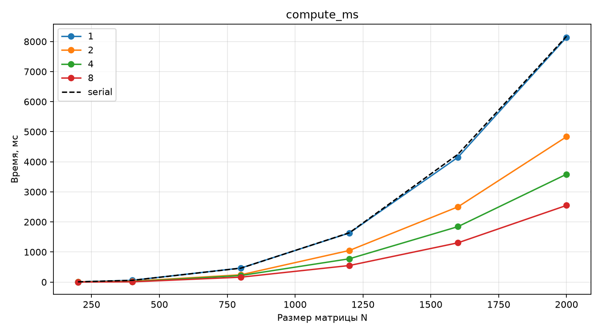
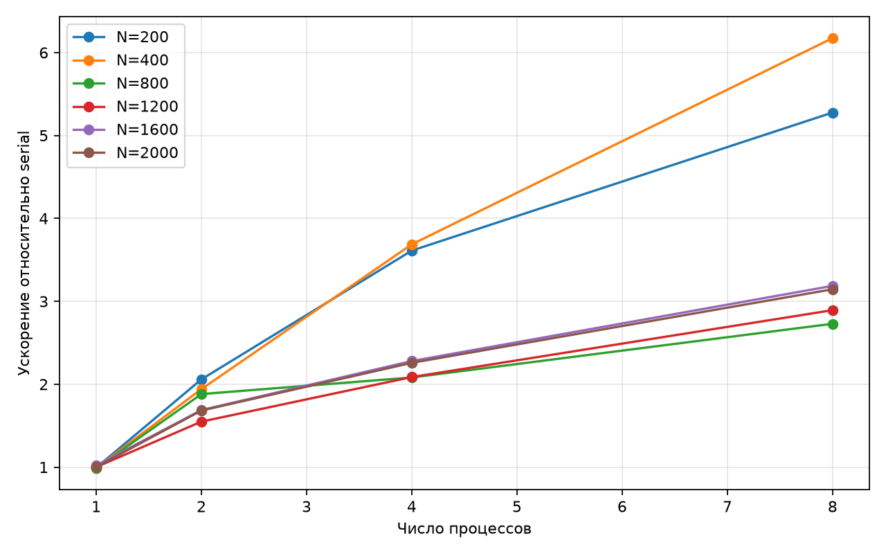
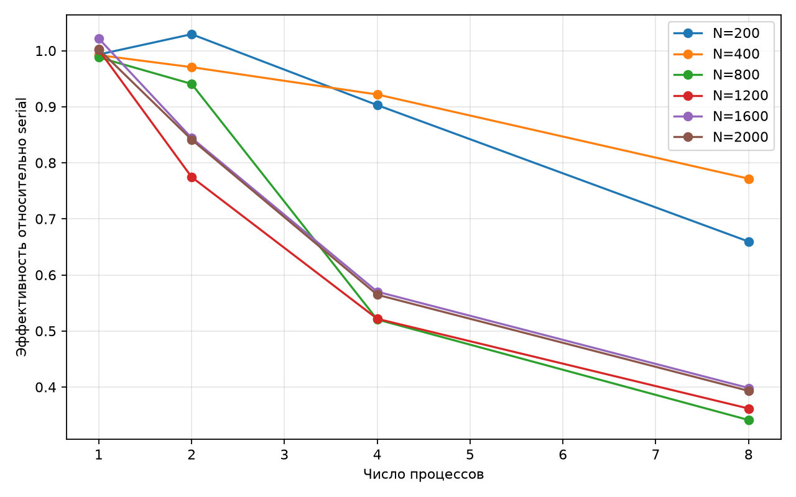
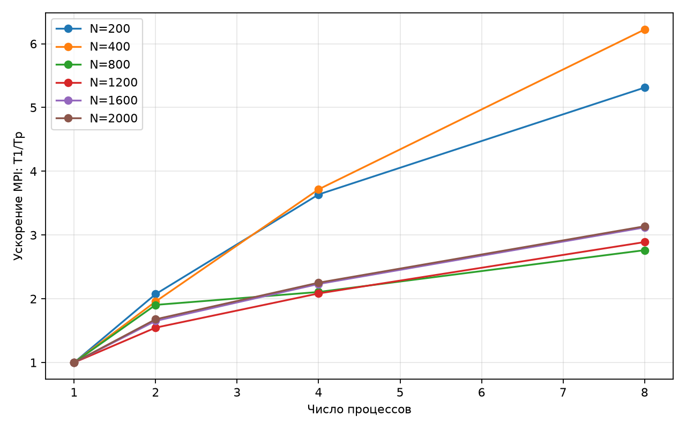
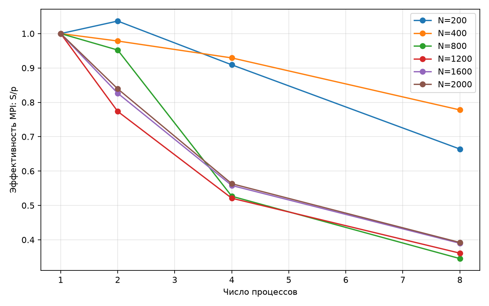

# Лабораторная работа №3 — параллельное умножение матриц с MPI

Дисциплина: параллельное программирование. Автор: C1REX-CEO.

Эксперименты выполнены **11 ноября 2026 года на суперкомпьютере «Сергей Королёв»**, узел `n239.ssc`. Основное задание Slurm — **345027**, предварительная проверка — **345026**. Завершены 18 последовательных и 72 MPI-запуска основной серии; все результаты прошли автоматизированную проверку. Данные, код и графики сохранены вместе с отчётом.

## 1. Задание и состав решения

Модифицировать программу умножения квадратных матриц из ЛР №1 для работы по технологии MPI. Исследовать зависимость времени от размера матриц и числа вычислительных ядер. MPI-программу необходимо запустить на «Сергее Королёве». Результаты проверить независимой библиотекой. Полные условия: [assignments.txt](../assignments.txt).

| Файл | Назначение |
|---|---|
| [serial.cpp](serial.cpp) | Последовательная программа без MPI и OpenMP |
| [main.cpp](main.cpp) | MPI-программа с распределением строк |
| [matrix.hpp](common/matrix.hpp) | Проверка входа, ввод/вывод, ядро умножения |
| [prepare_slurm.py](prepare_slurm.py) | Подготовка входов и независимых эталонов NumPy локально |
| [run_portable.py](run_portable.py) | Серия запусков и проверка результатов на сервере |
| [submit_slurm.sh](submit_slurm.sh), [job.slurm](job.slurm), [slurm_mpirun.sh](slurm_mpirun.sh) | Сборка на узле входа и выполнение через Slurm |
| [summarize.py](experiments/summarize.py) | Медианы, ускорения, эффективность и графики |

Входные файлы A и B содержат размер N, затем N строк по N целых чисел. Результат C записывается в том же формате. Отдельный CSV содержит N, число процессов, время и производительность. Матрицы хранятся в непрерывных массивах `long long`; целочисленная арифметика сохранена относительно исходной задачи.

Чтение проверяет размер, полноту данных, отсутствие лишних элементов и ограничение абсолютных значений, исключающее переполнение суммы произведений. Размеры A и B должны совпадать. Ошибка чтения на процессе 0 передаётся остальным процессам; при непредвиденной ошибке используется `MPI_Abort`.

## 2. Последовательный и параллельный алгоритмы

Обе программы используют одинаковое ядро с порядком циклов `i-k-j`:

```cpp
for (int i = 0; i < rows; ++i)
    for (int k = 0; k < n; ++k) {
        const long long x = a[static_cast<size_t>(i)*n+k];
        for (int j = 0; j < n; ++j)
            c[static_cast<size_t>(i)*n+j] += x*b[static_cast<size_t>(k)*n+j];
    }
```

Последовательная программа обрабатывает N строк, MPI-процесс — свою полосу. Процесс 0 читает матрицы и определяет распределение. При p процессах каждый получает `N/p` строк, а первые `N%p` процессов — ещё по одной. Числа элементов и смещения хранятся в `counts` и `offsets`. Например, N=7 и p=4 дают полосы 2, 2, 2, 1 строки. При p>N процессы без строк участвуют в коллективных операциях с нулевым числом элементов.

Последовательность MPI-операций:

1. Передача статуса чтения и размера N через `MPI_Bcast`.
2. Рассылка полной B через `MPI_Bcast`.
3. Распределение строк A через `MPI_Scatterv`.
4. Независимое умножение своей полосы A на B каждым процессом.
5. Сбор строк C через `MPI_Gatherv`, запись результата процессом 0.

Для элементов применяется `MPI_LONG_LONG_INT`. Нагрузка отличается не более чем на одну строку. Арифметическая сложность всей задачи — O(N³), работы одного процесса — примерно O(N³/p). Полная B занимает O(N²) памяти на каждом процессе, локальные полосы A и C — O(N²/p). Процесс 0 дополнительно хранит полные A и C. Дублирование B и централизованные распределение/сбор ограничивают масштабирование этой схемы.

## 3. Окружение и выделение ресурсов

| Параметр | Фактическое значение |
|---|---|
| Суперкомпьютер / узел | «Сергей Королёв», `n239.ssc` |
| Процессоры | 2 × Intel Xeon X5670, номинально 2.93 ГГц |
| Ядра | 6 на сокет, 12 физических ядер; 1 логический поток на ядро |
| NUMA | 2 домена: CPU 0–5 и CPU 6–11 |
| ОС | CentOS 7.9, Linux 3.10.0-1160.el7.x86_64 |
| Компилятор | Intel C++ 18.0.2, `-O2 -std=c++14` |
| MPI | Intel MPI 5.1.3; обёртка компилятора `mpiicpc` |
| Планировщик | Slurm, очередь `batch` |
| Python на узле | 3.6.8, стандартная библиотека без NumPy |
| Подготовка эталонов | Локальный NumPy 2.5.4 |

Подтверждения: [окружение узла](results_korolev/345027-full/cluster_environment.txt), [метаданные](results_korolev/345027-full/environment.json), [окружение сборки](results_korolev/345027-full/build_environment.txt), [динамические библиотеки](results_korolev/345027-full/runtime_libraries.txt).

Запрошены один узел, 8 задач по одному ядру, 4 ГБ памяти и один час. **Фактически Slurm выделил весь узел: `NumCPUs=12`, `NumTasks=8`.** Выделение оставалось постоянным; число активных MPI-процессов менялось: 1, 2, 4, 8. Исследуется использование разного числа физических ядер внутри одного выделенного узла, а не изменение размера выделения Slurm.

Использованы `I_MPI_FABRICS=shm`, `I_MPI_PIN=1`, `I_MPI_PIN_DOMAIN=core`. Журналы Intel MPI показывают привязку рангов к CPU 0…p−1; пример: [2000_mpi_8_0.log](results_korolev/345027-full/2000_mpi_8_0.log). При p≤4 ранги находятся в первом NUMA-домене, при p=8 задействованы оба. В логах есть предупреждение `srun: cluster configuration lacks support for cpu binding`: привязку выполнял Intel MPI, его таблицы `Pin cpu` подтверждают отдельные ядра для рангов. Последовательная программа работала одним процессом без явного закрепления за определённым ядром.

Сборка выполнена на `login2`: на вычислительном узле Intel-компилятору не хватало настроек заголовков GCC. До отправки собраны обе программы и сохранены хеши исходников и бинарников. В Slurm запускалась конкретная сохранённая сборка; вычисления на узле входа не выполнялись.

## 4. Методика измерений

Основная серия: N=200, 400, 800, 1200, 1600, 2000; отдельная последовательная программа и MPI с p=1, 2, 4, 8. Каждая конфигурация повторена **три раза**: 6 × 3 = 18 последовательных и 6 × 4 × 3 = 72 MPI-измерения, всего **90**. Для данного N все запуски получают одинаковые матрицы. Представлена медиана трёх времён; исходные значения и min–max сохранены отдельно.

В serial `std::chrono::steady_clock` измеряет только вызов умножения. В MPI перед измерением выполняется `MPI_Barrier`; `MPI_Wtime` измеряет две длительности на каждом процессе:

- `total_ms`: рассылка B, распределение A, локальное умножение и сбор C;
- `compute_ms`: только локальное умножение.

`MPI_Reduce` с `MPI_MAX` выбирает максимальную длительность среди процессов отдельно для каждого показателя. Файловый ввод/вывод, выделение буферов, старт процессов, начальная передача статуса и N, барьер перед измерением и редукция статистики исключены. Разность `total_ms − compute_ms` не является точным временем обмена: максимумы могут принадлежать разным процессам, также присутствует ожидание.

Длительности определяются разностями внутри процесса. Календарные часы узла входа и вычислительного узла в журналах не согласованы; по их разности время не вычислялось. Три повтора дают медиану и диапазон, но не полноценную оценку доверительного интервала. Конфигурации запускались последовательно без рандомизации порядка.

Две базы сравнения измерены в том же задании:

- **Sserial = Tserial / Tmpi(p)**, **Eserial = Sserial / p** — относительно отдельной последовательной программы;
- **Smpi = Tmpi(1) / Tmpi(p)**, **Empi = Smpi / p** — масштабирование самой MPI-программы.

Делятся медианы соответствующих серий. Производительность `2*N³/t` приводится в GOPS: арифметика целочисленная, не FLOPS.

## 5. Автоматизированная верификация

Входы создаются `NumPy.default_rng`, seed `42+N`, целые элементы −10…10. Независимый эталон C=A×B вычисляется локально NumPy через float64 с преобразованием в int64. Любая частичная целая сумма по модулю ограничена `100*N`, значительно меньше 2⁵³, поэтому для этих данных результат float64 точен. При N≤200 эталон дополнительно сопоставляется с NumPy int64 matmul.

На сервер передаются сжатые входы и SHA256 канонической текстовой записи A, B и эталонной C. [run_portable.py](run_portable.py) проверяет входы, а после **каждого запуска** сверяет SHA256 всей выходной матрицы с эталоном NumPy. Нормализуются только CRLF/LF. Это проверка полного результата по криптографическому хешу, а не выборка элементов и не только сравнение serial с MPI. Прямое поэлементное сравнение на сервере не выполнялось; вероятность коллизии SHA256 пренебрежимо мала. Проверка не входит во время умножения.

Все **90 основных запусков** имеют `verified=True` и совпадающий эталонный хеш. Поле `max_abs_error=0` устанавливается после совпадения хеша; это не отдельно вычисленная на сервере норма ошибки. До основной серии проверены N=1,3,17, serial и MPI p=1,2,4,8 — **15 успешных запусков**, в том числе p>N и некратное распределение строк.

Подтверждения: [SUCCESS основной серии](results_korolev/345027-full/SUCCESS.txt), [SUCCESS пробы](results_korolev/345026-smoke/SUCCESS.txt), [основной протокол](results_korolev/345027-full/run.log), [пробный протокол](results_korolev/345026-smoke/run.log), [исходный архив с сервера](results_korolev/lab3-results-345027.tar.gz). Дополнительные прежние локальные проверки неправильных файлов и граничных случаев: [checks.json](checks.json), [checks_serial.json](checks_serial.json). Они не являются отдельными кластерными измерениями.

## 6. Результаты на «Сергее Королёве»

Медианы времени, мс. MPI-время включает обмен данными:

| N | Serial | MPI 1 | MPI 2 | MPI 4 | MPI 8 |
|---:|---:|---:|---:|---:|---:|
| 200 | 8.0029 | 8.0578 | 3.8872 | 2.2159 | 1.5168 |
| 400 | 58.3863 | 58.8548 | 30.0770 | 15.8341 | 9.4571 |
| 800 | 462.1380 | 467.7420 | 245.6229 | 222.0042 | 169.3208 |
| 1200 | 1639.9672 | 1637.7060 | 1058.5759 | 785.9070 | 566.7889 |
| 1600 | 4251.0277 | 4161.0210 | 2517.2498 | 1864.3532 | 1334.1470 |
| 2000 | 8175.3470 | 8154.6099 | 4858.3210 | 3620.1720 | 2599.1540 |




Для N=2000 медиана отдельной последовательной программы составляет 8175.3470 мс:

| Процессы | Tmpi, мс | Sserial | Eserial, % | Smpi | Empi, % |
|---:|---:|---:|---:|---:|---:|
| 1 | 8154.6099 | 1.003 | 100.3 | 1.000 | 100.0 |
| 2 | 4858.3210 | 1.683 | 84.1 | 1.678 | 83.9 |
| 4 | 3620.1720 | 2.258 | 56.5 | 2.253 | 56.3 |
| 8 | 2599.1540 | 3.145 | 39.3 | 3.137 | 39.2 |

На восьми процессах время MPI лежит в диапазоне 2592.4630–2605.6290 мс. Для MPI на одном процессе диапазон — 7945.8368–8176.3201 мс. Min–max всех конфигураций: [summary.csv](results_korolev/345027-full/summary.csv).





Отдельно представлено масштабирование относительно MPI на одном процессе:





Исходные данные: [72 MPI-измерения](results_korolev/345027-full/raw.csv), [18 последовательных измерений](results_korolev/345027-full/serial/raw.csv). Сводные таблицы, включая `compute_ms` и обе базы сравнения: [tables.md](results_korolev/345027-full/tables.md). Предварительная локальная серия Windows сохранена отдельно в [LOCAL_REPORT.md](LOCAL_REPORT.md) и не использована для ускорений этого отчёта.

## 7. Анализ и выводы

1. Распределение строк и сборка результата работают корректно. Все 90 основных и 15 пробных запусков на суперкомпьютере совпали с независимыми эталонами NumPy, включая p>N и некратное распределение.
2. На каждом исследованном N увеличение числа MPI-процессов от 1 к 2, 4 и 8 уменьшает медиану полного времени. Для N=2000 получены 8.175 с в последовательной программе и 2.599 с на восьми процессах: **ускорение 3.145 раза, эффективность 39.3%**. Относительно MPI p=1 ускорение — 3.137 раза.
3. Наибольшее ускорение на восьми процессах в этой серии получено при N=400: **6.174 раза относительно serial, эффективность 77.2%**. Рост N не гарантирует лучшую эффективность: при N=800 она равна 34.1%, при N=1200 — 36.2%.
4. Для N=200 и p=2 ускорение относительно serial составляет 2.059, эффективность — 102.9%. Значение сохранено без ограничения сверху. Небольшое сверхлинейное ускорение может быть связано с использованием кэша, изменением частоты и разбросом измерений; трёх повторов без аппаратных счётчиков недостаточно, чтобы установить причину.
5. Снижение эффективности больших матриц согласуется с возможным влиянием общей памяти и кэшей. При p=8 дополнительно задействованы два NUMA-домена. Это гипотезы: счётчики памяти, NUMA-доступов и подробный профиль MPI не собирались; количественно разделить вклад факторов по этим данным нельзя.
6. Раздача A и сбор C через процесс 0, а также полная копия B на каждом процессе ограничивают масштабирование. Возможные улучшения — блочное умножение и двумерное распределение; их эффект здесь не измерялся.

Обязательный запуск MPI на «Сергее Королёве» выполнен. Выводы относятся к **одному узлу** и 1–8 активным процессам; межузловая сеть и несколько узлов не исследованы. Последовательная база не закреплялась за фиксированным ядром, что ограничивает интерпретацию небольших различий времени.

## 8. Воспроизведение

Подробная инструкция работы с кластером: [SLURM.md](SLURM.md). На локальном компьютере с NumPy из корня репозитория:

```powershell
..\.lab-tools\python\python.exe lab3/prepare_slurm.py
```

После загрузки `lab3-upload` выполнить на узле входа:

```bash
cd ~/lab3-upload
bash lab3/submit_slurm.sh smoke
# После успешной пробы:
bash lab3/submit_slurm.sh full
```

Скрипт собирает обе программы до отправки, сохраняет отдельную папку сборки и вызывает `sbatch`. В задании проверяются хеши исходников и исполняемых файлов. MPI-расчёты выполняются в выделении Slurm; прежние PBS-скрипты для этого окружения не используются.

После скачивания результатов таблицы и графики строятся из исходных CSV, из корня репозитория:

```powershell
..\.lab-tools\python\python.exe experiments/summarize.py mpi --input lab3/results_korolev/345027-full --serial-input lab3/results_korolev/345027-full/serial
```

При новом запуске номера заданий и пути изменятся. Числа этого отчёта относятся именно к сохранённой серии 345027.