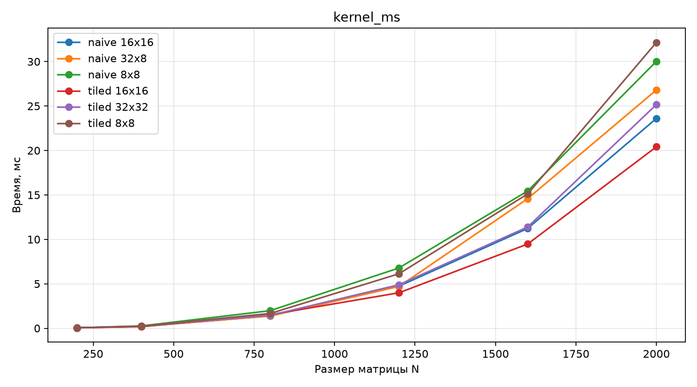
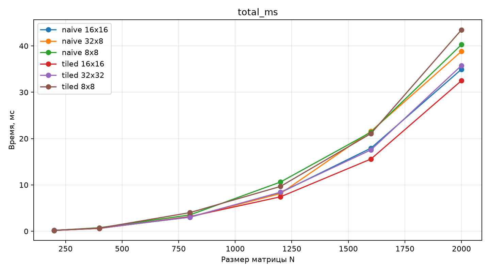

# Лабораторная работа №4 — умножение матриц с CUDA

## 1. Задание

Модифицировать программу ЛР №1 для CUDA. Исследовать зависимость времени от
размера матриц и конфигурации сетки блоков. Проверить результаты сторонней библиотекой.

## 2. Реализация

Исходный код: [main.cu](main.cu), чтение/запись матриц: [matrix.hpp](common/matrix.hpp).
Данные — квадратные матрицы целых чисел `long long`, результат также целочисленный.
Матрицы хранятся подряд в памяти: индекс элемента `(i,j)` равен `i*N+j`.

Реализованы два CUDA-ядра:

1. `multiply_naive`: один поток вычисляет один элемент C, перебирая все N значений k.
   Блоки 8×8, 16×16, 32×8; сетка — `ceil(N/block_x) × ceil(N/block_y)`.
2. `multiply_tiled<T>`: блок вычисляет плитку C размером T×T. Потоки совместно
   загружают плитки A и B в `__shared__` память, затем используют их T раз.
   Проверяются T=8, 16 и 32. На каждой итерации есть два `__syncthreads()`:
   после загрузки и перед перезаписью плиток.

При некратном N недостающие элементы плиток заменяются нулями. Потоки за границами
результата не записывают C, но участвуют в обеих синхронизациях: ранний выход
в блочном ядре привёл бы к некорректному барьеру. У каждого элемента C один писатель,
поэтому атомарные операции не нужны.

Для N=2000 сетки соответственно: 250×250 (8×8), 125×125 (16×16),
63×250 (32×8), 63×63 (32×32). Точные размеры каждой сетки записаны в `raw.csv`.

## 3. Методика

Дата: 6 ноября 2026. Windows 10, Intel Core i5-11400F, NVIDIA GeForce RTX 3060 12 GB,
драйвер 621.01. CUDA Toolkit 12.8, nvcc 12.8.93, MSVC toolset 14.44,
сборка `-O2 -std=c++17 -arch=sm_86`. Метаданные: [environment.json](results/environment.json).

Размеры N: 200, 400, 800, 1200, 1600, 2000. Шесть конфигураций, три повтора:
**108 запусков**, все результаты полностью совпали с NumPy. Вход — числа от −10
до 10, seed `42+N`. Проверка вне замера, условия точности описаны в [RUNNING.md](../RUNNING.md).

Перед каждым замером выполняется один прогревочный запуск того же ядра.
`kernel_ms` измеряется CUDA Events только вокруг ядра. `total_ms` измеряется
`steady_clock` и включает повторное копирование A/B CPU→GPU, ядро, синхронизацию
и копирование C GPU→CPU. Выделение памяти, создание CUDA-контекста, прогрев,
файловый ввод/вывод и проверка исключены из обоих показателей.
Поэтому `total_ms` — время обработки уже загруженных матриц с обменом CPU/GPU,
а не полное время запуска процесса.

В таблицах медианы трёх повторов. Сырые данные и min–max:
[raw.csv](results/raw.csv), [summary.csv](results/summary.csv),
[все таблицы](results/tables.md). Показатель `2*N³/t` выражен в **GOPS**:
используется целочисленная арифметика, не FP32/FP64 и не Tensor Cores.

## 4. Результаты

Время ядра, мс:

| N | naive 8×8 | naive 16×16 | naive 32×8 | tiled 8×8 | tiled 16×16 | tiled 32×32 |
|---:|---:|---:|---:|---:|---:|---:|
| 200 | 0.0555 | 0.0531 | 0.0567 | 0.0544 | 0.0525 | 0.0598 |
| 400 | 0.2656 | 0.2012 | 0.2043 | 0.2276 | 0.1791 | 0.2326 |
| 800 | 1.9787 | 1.3879 | 1.3738 | 1.6641 | 1.5314 | 1.4585 |
| 1200 | 6.7836 | 4.7364 | 4.7029 | 6.1323 | 3.9911 | 4.8965 |
| 1600 | 15.4433 | 11.2306 | 14.5820 | 15.1112 | 9.4773 | 11.3981 |
| 2000 | 30.0323 | 23.6096 | 26.8119 | 32.1605 | 20.4156 | 25.1686 |



Время с передачами CPU↔GPU для N=2000:

| Конфигурация | total_ms | kernel_ms |
|---|---:|---:|
| naive 8×8 | 40.2814 | 30.0323 |
| naive 16×16 | 34.9591 | 23.6096 |
| naive 32×8 | 38.8239 | 26.8119 |
| tiled 8×8 | 43.4809 | 32.1605 |
| tiled 16×16 | 32.5076 | 20.4156 |
| tiled 32×32 | 35.7655 | 25.1686 |



## 5. Анализ и выводы

1. На N=2000 лучшее измеренное ядро — `tiled 16×16`: 20.416 мс,
   приблизительно 783.7 GOPS. Оно быстрее `naive 16×16` примерно в 1.16 раза.
   С учётом передач выигрыш уменьшается до 1.08 раза (34.959/32.508).
2. Использование shared memory не гарантирует выигрыш при любой конфигурации.
   `tiled 8×8` на N=2000 медленнее обычного ядра 8×8. Возможные причины —
   больше итераций загрузки/барьеров и меньшая степень повторного использования
   данных. Без профилировщика это объяснение является гипотезой.
3. Блок 32×32 содержит 1024 потока, но на больших матрицах уступает 16×16.
   Самый большой допустимый блок не обязательно лучший: влияют регистры,
   shared memory и число одновременно размещаемых блоков. Occupancy здесь
   отдельно не измерялась.
4. На N=800 лучший результат в этой серии у `naive 32×8`, а не у блочного ядра.
   Значит, выбирать конфигурацию нужно по измерениям на целевом размере.
5. Передачи существенны: для `tiled 16×16`, N=2000 разница медиан полного
   времени и времени ядра составляет около 12.1 мс. Это оценка совокупных
   накладных расходов, а не отдельный замер пропускной способности PCIe.
6. Замеры выполнены на GPU, обслуживающей рабочий стол Windows. Три повтора
   и медиана уменьшают влияние выбросов, но не устраняют колебания частоты и фоновую нагрузку.

## 6. Верификация и воспроизведение

Дополнительно выполнено **42 проверки**: N=1,2,3,7,17,33 для шести конфигураций
и шесть некорректных входов. Журнал: [checks.json](checks.json).

```bash
make cuda CUDA_ARCH=sm_86
./build/matrix_cuda 'Matrix(A).txt' 'Matrix(B).txt' C.txt stats.csv tiled 16 16
python3 experiments/check.py cuda --exe build/matrix_cuda
python3 experiments/run.py cuda --exe build/matrix_cuda --label my-gpu --out lab4/results
python3 experiments/summarize.py cuda --input lab4/results
```

Команды Windows и зависимости — [RUNNING.md](../RUNNING.md).
