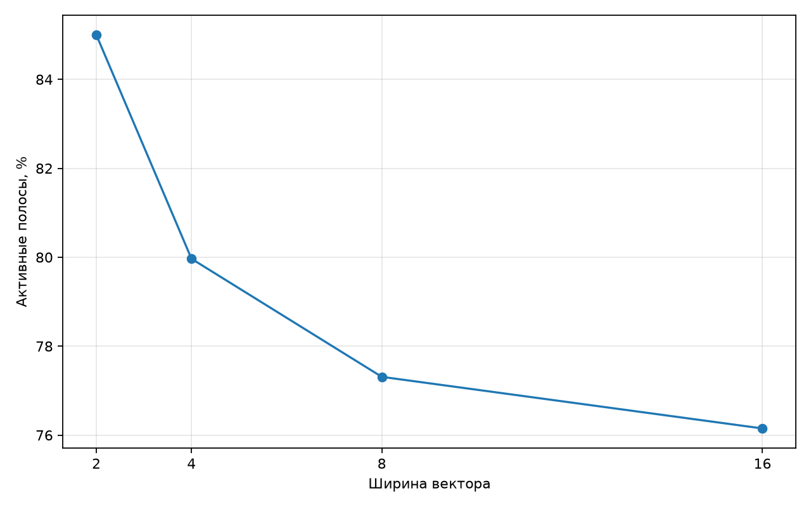
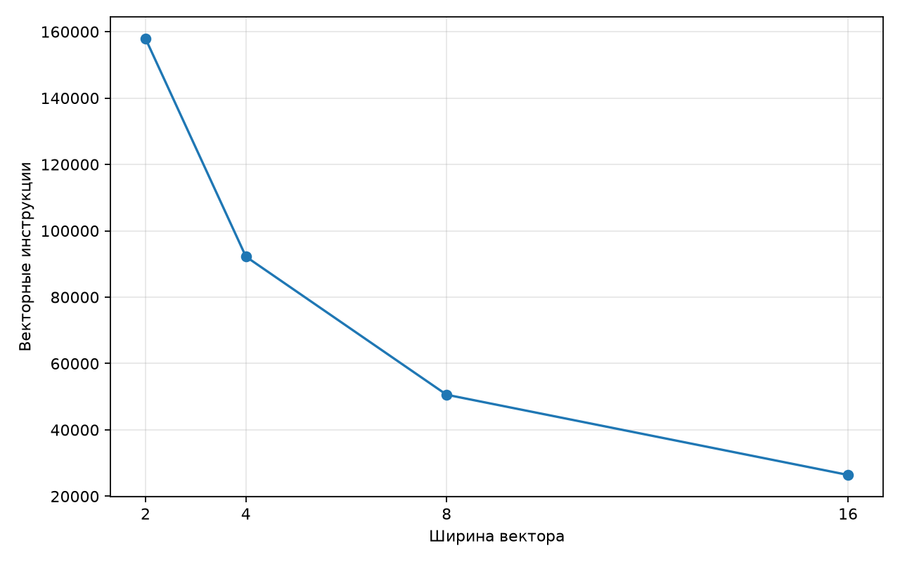

# Лабораторная работа №5 — SIMD, Stanford CS149 Program 2

## 1. Задание и исходная программа

Выбрана **Program 2: Vectorizing Code Using SIMD Intrinsics** из
[Stanford CS149 Assignment 1](https://github.com/stanford-cs149/asst1#program-2-vectorizing-code-using-simd-intrinsics-20-points).
Нужно реализовать `clampedExpVector` для любых N и ширины вектора, исследовать
загрузку полос при ширинах 2,4,8,16 и N=10000. Дополнительно выполнено бонусное
суммирование `arraySumVector`.

Исходный код: [main.cpp](main.cpp), [CS149intrin.h](CS149intrin.h),
[CS149intrin.cpp](CS149intrin.cpp), [logger.cpp](logger.cpp), [logger.h](logger.h).
Происхождение и изменения учебного каркаса: [UPSTREAM.md](UPSTREAM.md).

Библиотека имитирует SIMD-инструкции и считает активные полосы. Она **не является
аппаратной реализацией AVX/SSE**. По заданию исследуются число модельных инструкций
и загрузка полос; время выполнения самого эмулятора не характеризует скорость SIMD-процессора.

## 2. Возведение в степень с ограничением

Для каждого элемента вычисляется `values[i]^exponents[i]`; результат сверху
ограничивается `9.999999f`. При нулевой степени результат равен 1.
Экспериментальные степени — от 0 до 9, значения — от −1 до 3.

Алгоритм обрабатывает по W элементов:

1. `valid` включает только существующие элементы последней группы: `min(W,N-i)`.
2. Загружаются основания и степени. Маска `isZero` выделяет нулевые степени.
3. Результат инициализируется основанием, а для `isZero` записывается единица.
4. Счётчик равен степени минус один. Пока хотя бы одна полоса активна,
   выполняются умножение и уменьшение счётчика только для незавершённых полос.
5. Сравнение с верхней границей создаёт маску ограничения. Результат записывается
   только по `valid`.

Векторные регистры и маски инициализированы, поэтому в неактивных полосах нет
чтения неинициализированных значений. Хвост не выходит за пределы входа/выхода.
В отличие от готового примера `absVector`, здесь не используется безусловная
маска всех полос для последней неполной группы.

## 3. Эксперимент с шириной вектора

Дата: 6 ноября 2026. MSVC 14.44, `/O2 /std:c++17`, Windows 10, i5-11400F.
Эти сведения нужны для воспроизведения сборки, но счётчики модели не измеряют
характеристики этого CPU. Вход одинаков для всех ширин: фиксированный генератор
с seed=42, N=10000. Код генератора приведён в `initValue`.

| W | Векторные инструкции | Активные полосы | Всего полос | Загрузка, % |
|---:|---:|---:|---:|---:|
| 2 | 157895 | 268423 | 315790 | 85.00 |
| 4 | 92215 | 294961 | 368860 | 79.97 |
| 8 | 50593 | 312909 | 404744 | 77.31 |
| 16 | 26422 | 321925 | 422752 | 76.15 |

Все результаты совпали с последовательной реализацией с допуском исходного
проверяющего кода 1e-5. Счётчики для обязательной части снимаются **до** бонусной суммы.
Данные: [results.csv](results/results.csv); полные stdout — файлы `results/w*_n*.log`.




**Ответ на вопрос задания:** при увеличении W загрузка снижается.
У элементов разные степени, поэтому некоторые полосы завершают цикл раньше.
Оставшиеся итерации выполняются с частично отключёнными полосами, пока не закончит
элемент с наибольшей степенью в группе. В более широкой группе выше вероятность
одновременного присутствия коротких и длинных вычислений.

Число векторных инструкций при этом падает: примерно в 5.98 раза при переходе
от W=2 к W=16, хотя ширина увеличивается в 8 раз. Это отношение числа инструкций
в модели, а не измеренное ускорение реального CPU. Загрузка учитывает также
операции с масками и прочие инструкции по правилам предоставленного logger;
она не равна доле активных полос только в умножениях.

## 4. Бонус: сумма массива

Сначала выполняется поэлементное накопление в векторный аккумулятор — N/W
групп. Затем `hadd` складывает соседние полосы, а `interleave` переносит результаты
в первую половину. Повторение `log2(W)` раз даёт общую сумму в нулевой полосе.
Для степеней двойки сложность в модели векторных операций — **O(N/W + log W)**.
Промежуточные регистры разделены: `interleave` не вызывается с совпадающими
входом и выходом. При другой ширине используется скалярное сведение W сумм,
что даёт O(N/W + W).

Порядок сложений отличается от последовательного, поэтому float-результат
может немного отличаться из-за округления. Использован допуск исходного задания
0.2; бонус проверяется при N, кратном W. Он прошёл во всех таких тестах.
Внутри C++-эмулятора одна векторная инструкция сама содержит цикл по W;
указанная сложность относится к SIMD-модели, не к работе эмулятора.

## 5. Проверки

Выполнено **36 запусков** для W=1,2,3,4,8,16, включая N=1, N=3, N=W,
N=W+1, N=2W−1, N=2W и N=10000 (повторяющиеся размеры исключаются).
Проверяется и защитная область после выходного массива: она должна остаться
неизменной. Журнал: [checks.json](results/checks.json).

Проверки охватывают нулевые степени, отрицательные/положительные основания,
срабатывание ограничения и неполные векторы. При ошибке приложение и скрипт
завершаются с ненулевым кодом, поэтому ошибочный результат не попадает в таблицу.

## 6. Сборка и повторение

```bash
make simd
./build/myexp_4 -s 3 -l
python3 lab5/run_experiments.py --pattern 'build/myexp_{width}'
python3 experiments/summarize.py simd --input lab5/results
```

На Windows: `build_windows.cmd`, затем `python lab5/run_experiments.py`.
Подробнее — [RUNNING.md](../RUNNING.md).

## 7. Выводы

Маски позволяют векторизовать цикл с разным числом итераций у элементов и
безопасно обработать хвост массива. Увеличение ширины уменьшило число инструкций,
но снизило долю активных полос с 85.00% до 76.15% из-за расхождения числа итераций.
Горизонтальная редукция позволяет суммировать векторные частичные суммы за log2(W)
шагов при ширине, равной степени двойки.
